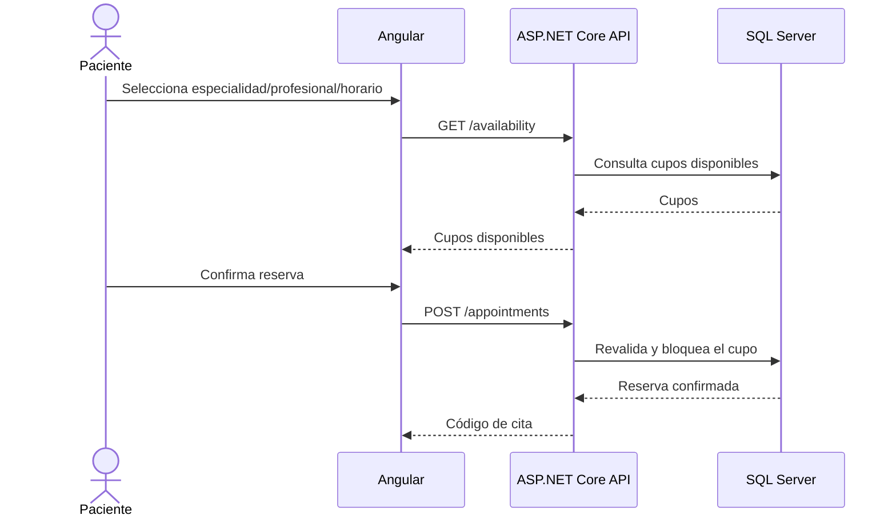

# Arquitectura técnica

## Capas

1. **Presentación:** Angular + HTML + CSS + TypeScript.
2. **Aplicación:** ASP.NET Core Web API en C#.
3. **Datos:** SQL Server mediante Entity Framework Core.
4. **Integraciones:** se agregarán detrás de servicios/controladores, sin acoplar el frontend directamente a proveedores externos.

## Flujo de una reserva

## Seguridad base

- Contraseñas almacenadas mediante `PasswordHasher`, nunca en texto plano.
- JWT para autenticación de la API.
- Roles en claims (`Paciente`, `Profesional`, `Administrador`, `Caja`).
- Endpoints protegidos con `[Authorize]`.
- Datos de semilla totalmente ficticios.
- `appsettings.Development.json` ignorado por Git.

## Concurrencia de cupos

La reserva y la reprogramación se ejecutan dentro de una transacción y vuelven a comprobar que el slot continúe disponible. `AvailabilitySlot` incorpora `RowVersion` para detectar escrituras concurrentes.
